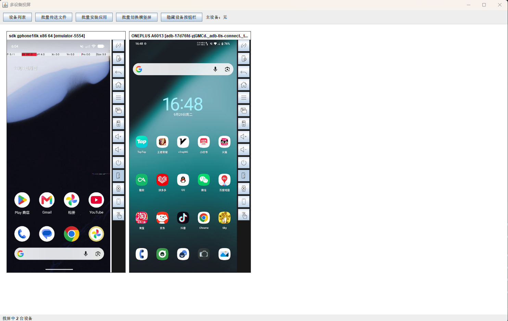
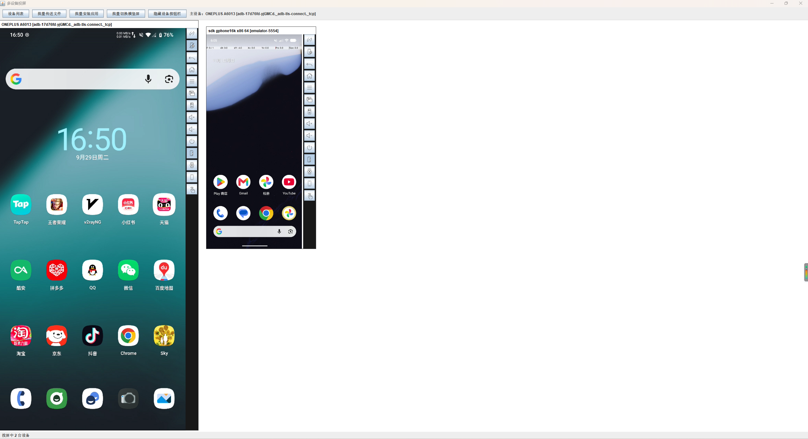
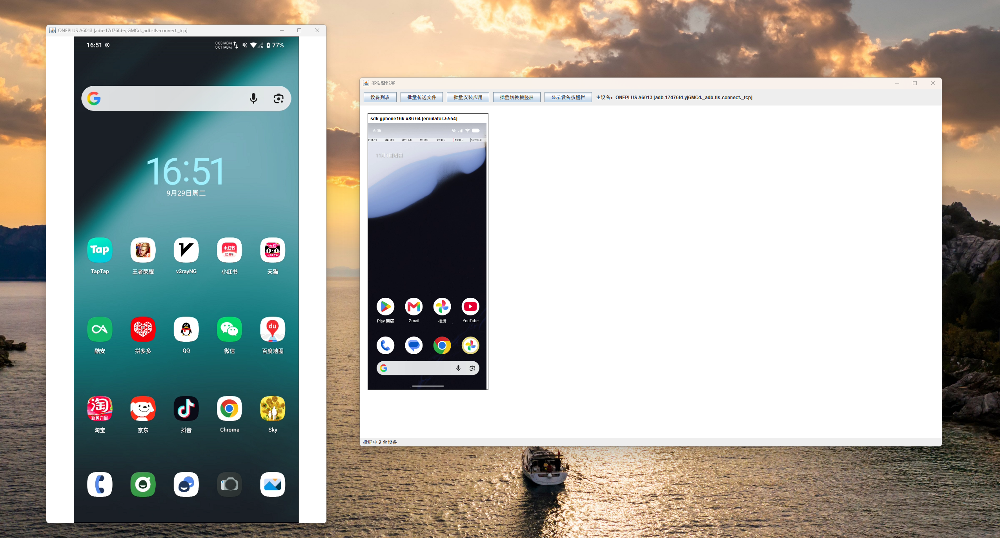
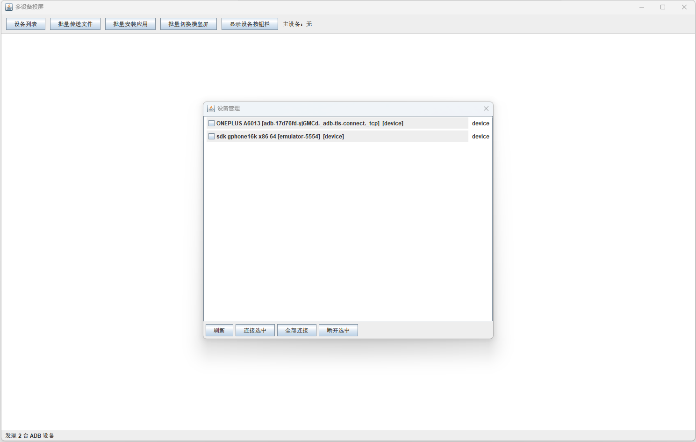
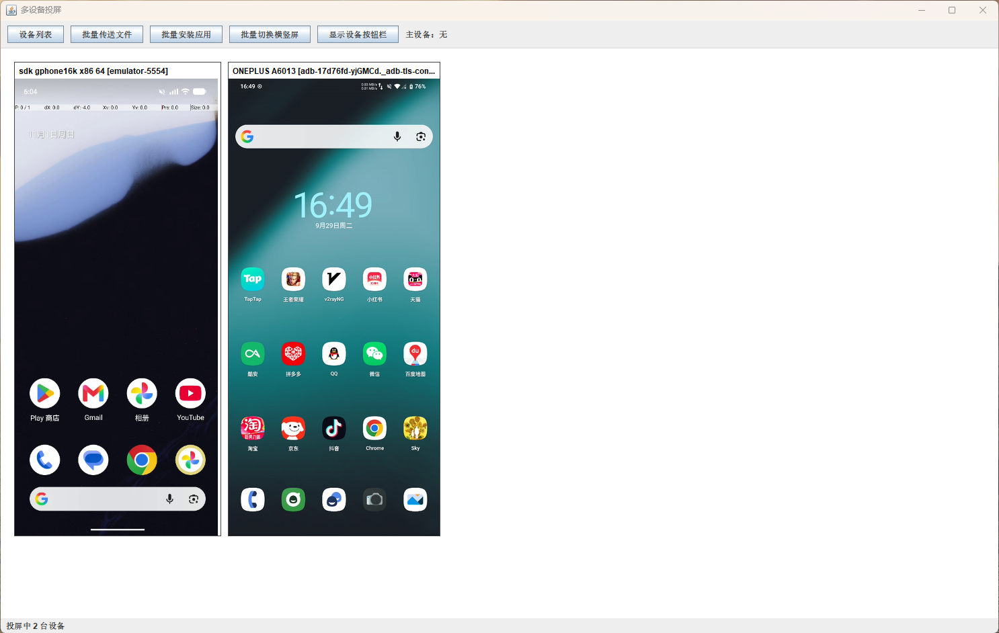
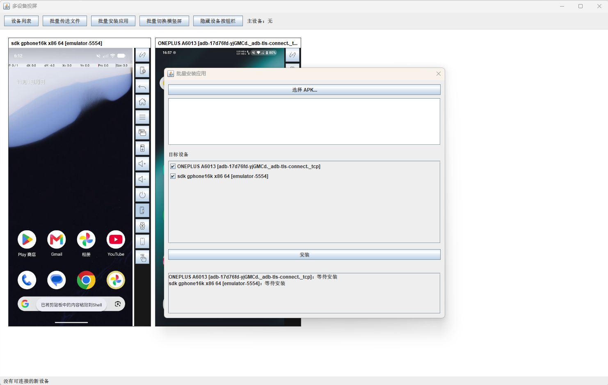
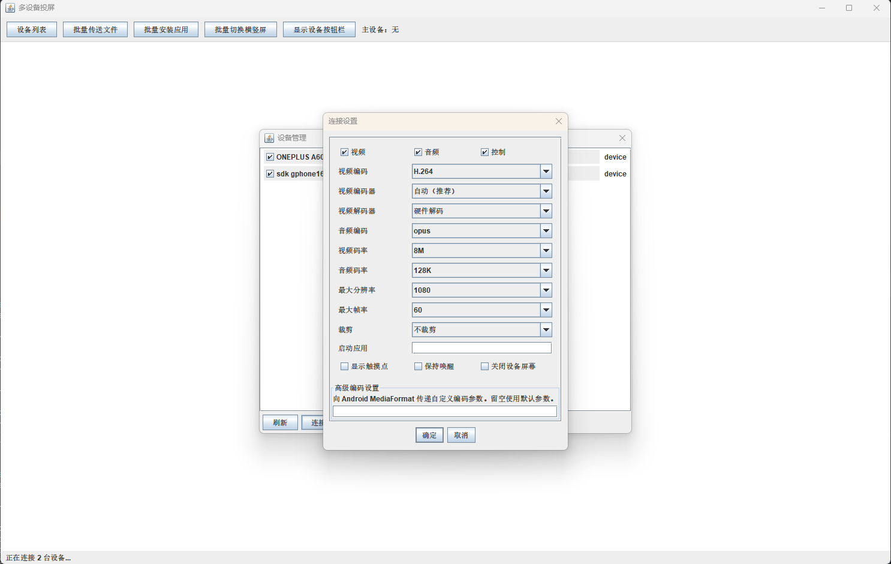

# scrcpy-java

<p align="center">
  <strong>基于 Java 的 Android 多设备投屏与群控桌面客户端</strong>
</p>

<p align="center">
  多设备同时投屏 · 主设备操作 · 群控同步 · 批量文件传输 · 批量安装 APK
</p>

<p align="center">
  <a href="#项目简介">项目简介</a> ·
  <a href="#功能特性">功能特性</a> ·
  <a href="#功能截图">功能截图</a> ·
  <a href="#快速开始">快速开始</a> ·
  <a href="#技术架构">技术架构</a>
</p>

<p align="center">
  <a href="README_EN.md">English</a>
</p>

---

## 项目简介

**scrcpy-java** 是一个基于 Java 开发的 Android 设备投屏与控制桌面客户端，使用 [scrcpy](https://github.com/Genymobile/scrcpy) Server 5.0.1 协议与 Android 设备通信。

项目最重要的特点是 **多设备同时投屏与群控**。它不局限于传统的一台手机对应一个投屏窗口，而是将多台 Android 设备集中到同一个桌面工作区：可以同时观察多台设备的实时画面，指定一台主设备作为操作入口，并将支持的控制操作同步分发给其他已连接设备。

适合需要同时管理多台 Android 设备的场景，例如：

- 多设备自动化测试与兼容性测试
- 手机矩阵、设备集中管理
- 多账号应用操作与内容运营
- 需要同时观察、操作多台设备的日常工作

> **项目仍在持续开发中。** 当前重点开发方向为 Swing 桌面客户端（`scrcpy-swing-poc`），不同功能在不同操作系统上的支持情况可能有所差异。

## 功能特性

### 多设备投屏与群控

- **多设备同屏：** 在一个桌面窗口中同时显示多台 Android 设备的实时画面。
- **主设备模式：** 将选中的设备设为主设备并放大显示，其余设备以较小画面排列，方便集中观察。
- **操作同步：** 从主设备画面执行支持的控制操作，并同步发送到其他已连接设备。
- **坐标适配：** 支持群控场景下的坐标适配，降低不同设备分辨率或画面尺寸差异带来的操作偏差。
- **设备布局管理：** 支持设备画面在主工作区嵌入显示，也支持拆分为独立窗口。
- **设备连接管理：** 查看设备列表、刷新设备状态，并按需连接或断开设备。

### 设备控制

- 支持 Android 触控操作。
- 支持 UHID 鼠标/键盘控制模式（取决于设备及运行环境）。
- 提供返回、主页、最近任务、电源、音量等常用控制入口。
- 支持屏幕开关、保持唤醒等设备操作。
- 支持桌面与 Android 设备之间的剪贴板文本交互。

### 批量设备操作

- **批量文件传输：** 选择多台设备，一次性向多台设备发送文件。
- **独立传输进度：** 展示每台设备的传输进度与完成状态。
- **批量安装 APK：** 对选中的多台设备执行应用安装。
- **任务状态查看：** 跟踪各设备任务执行情况，便于发现失败设备并单独处理。

### 音视频与连接配置

- 接收 scrcpy Server 推送的视频、音频和控制数据。
- 通过 FFmpeg 解码支持的视频与音频格式。
- 提供视频分辨率、帧率、码率及编码器等连接参数配置（具体选项以当前客户端版本为准）。
- Windows 环境集成原生 D3D11 视频渲染路径，具体硬件能力取决于显卡、驱动和运行环境。

## 功能截图

所有功能截图均存放在仓库的 [`assets/`](assets) 目录中。

### 1. 多设备同时投屏

在同一个工作区同时查看多台设备，无需逐台切换投屏窗口。



### 2. 多设备群控 — 嵌入模式

将多台设备放在同一个工作区，通过主设备进行集中操作。



### 3. 多设备群控 — 独立窗口

可以将设备画面拆分为独立窗口，按需调整桌面窗口布局。



### 4. 设备列表与工作区

设备列表及投屏工作区的不同显示状态。






### 5. 批量文件传输

选择目标设备，批量发送文件，并查看每台设备的处理进度。


### 6. 批量安装应用

向选中的多台 Android 设备批量安装 APK。



### 7. 设备连接配置

根据设备和网络环境调整投屏连接参数。



## 快速开始

### 环境要求

- **JDK：** 25
- **Maven：** 3.9 或更高版本
- **ADB：** Android Debug Bridge
- **Android 设备：** 开启开发者选项和 USB 调试，或已通过 ADB TCP/IP 连接

请先在电脑上授权 ADB 调试，并确认设备可以被 ADB 正常识别。

### 1. 获取项目

```bash
git clone https://github.com/849029780/scrcpy-java.git
cd scrcpy-java
```

### 2. scrcpy Server（已内置）

scrcpy Server 5.0.1 已随 Swing 客户端内置在：

`scrcpy-swing-poc/src/main/resources/scrcpy-server-v5.0.1.jar`

启动时，程序会从运行时 classpath 自动读取该资源，提取到系统临时目录，并校验 SHA-256 后通过 ADB 推送到 Android 设备。无需单独下载、手动放置或配置 Server 文件。

内置文件 SHA-256：

```text
764eb6f79811d5211fe9df341120882ba9994c7a61b897d7bf3fb662e53bc536
```

### 3. 连接 Android 设备

在 Android 手机上开启：

**设置 → 开发者选项 → USB 调试**

通过 USB 连接手机后，在命令行执行：

```bash
adb devices
```

确认设备状态为 `device`。如果使用网络 ADB，可先执行：

```bash
adb connect <设备IP>:<端口>
```

### 4. 编译并启动 Swing 客户端

在项目根目录执行：

```bash
mvn -pl scrcpy-swing-poc -am package
```

启动客户端：

```bash
mvn -pl scrcpy-swing-poc -am exec:java
```

Swing 客户端入口类：

```text
com.jian.scrcpy.swing.SwingScrcpyApp
```

> Windows D3D11 原生渲染依赖对应的本地动态库。若本地库未正确部署，相关硬件渲染能力可能不可用。

## 技术架构

| 模块/技术 | 用途 |
| --- | --- |
| Java 25 | 项目主要开发语言 |
| Java Swing | 当前重点开发的桌面 UI |
| Maven | 多模块构建与依赖管理 |
| ADB | Android 设备发现、连接与命令执行 |
| scrcpy Server 5.0.1 | Android 端画面采集与控制协议 |
| Netty 4.2.x | 视频、音频及控制数据传输 |
| FFmpeg 8.1.2 / JavaCPP | 音视频解码 |
| D3D11 | Windows 平台原生视频渲染集成 |

### Maven 模块

| 模块 | 说明 |
| --- | --- |
| `scrcpy-core` | scrcpy 协议、ADB 集成、Netty 数据传输、音视频处理及设备会话等核心能力 |
| `scrcpy-swing-poc` | Swing 桌面客户端、多设备工作区及群控交互 |

## 项目状态与说明

- 当前目标协议版本为 **scrcpy Server 5.0.1**，Server 文件已内置于 Swing 客户端，无需额外准备。
- 项目是独立的 Java 客户端实现，并非 Genymobile 官方 scrcpy 项目。
- 部分功能依赖操作系统、设备能力、ADB 状态、显卡驱动及原生组件。
- 项目仍在迭代中，欢迎通过 GitHub Issues 反馈问题或提出功能建议。

## 致谢

感谢以下开源项目：

- [Genymobile/scrcpy](https://github.com/Genymobile/scrcpy) — Android 投屏与控制协议
- [Netty](https://netty.io/) — 高性能异步网络框架
- [FFmpeg](https://ffmpeg.org/) — 音视频处理
- [JavaCPP](https://github.com/bytedeco/javacpp) — Java 原生库桥接

## License

请以仓库中的许可证文件及第三方组件声明为准。

---

## English

**scrcpy-java** is a Java desktop client for Android screen mirroring and control, built around the official scrcpy Server 5.0.1 protocol.

Its key focus is **multi-device screen mirroring and synchronized group control**. Multiple Android devices can be displayed in one workspace. A primary device can be enlarged as the control entry point, while supported actions are broadcast to other connected devices.

### Key features

- Simultaneous screen mirroring for multiple Android devices in one desktop workspace.
- Primary-device layout with synchronized group control.
- Embedded device views and detachable floating windows.
- Touch and UHID mouse/keyboard control where supported.
- Batch file transfer and batch APK installation with per-device progress.
- Clipboard interaction, FFmpeg-based media decoding, and configurable connection parameters.
- A Windows D3D11 rendering integration where the required native components are available.

### Build and run

Requirements: JDK 25, Maven 3.9+, and ADB. The scrcpy Server 5.0.1 artifact is bundled in the Swing client resources.

1. Clone the repository.
2. Enable USB debugging and verify the device with `adb devices`.
3. Build and launch:

```bash
mvn -pl scrcpy-swing-poc -am package
mvn -pl scrcpy-swing-poc -am exec:java
```

See the Chinese documentation above for detailed setup instructions and screenshots.

### Technology

Java 25 · Swing · Maven · ADB · scrcpy Server 5.0.1 · Netty 4.2.x · FFmpeg 8.1.2 · D3D11

This is an independent Java client, not the official Genymobile scrcpy project.
