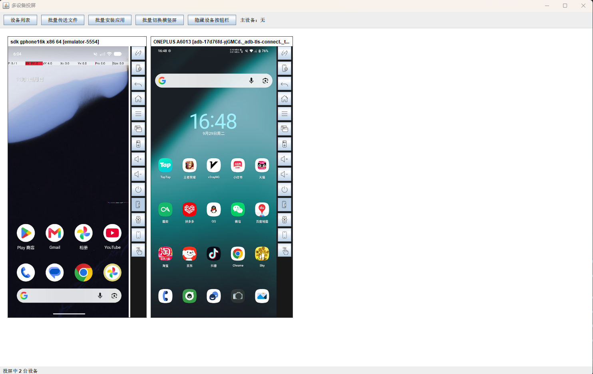
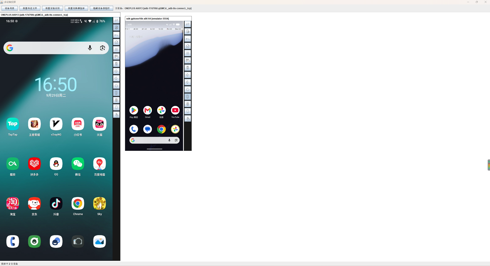
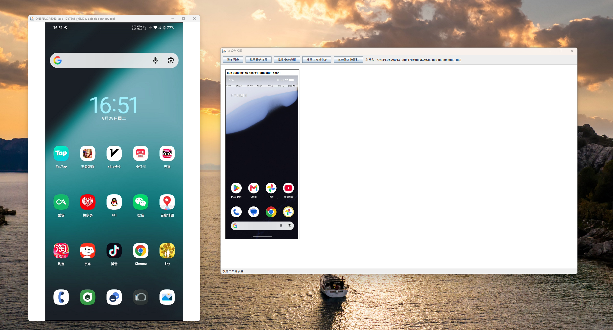
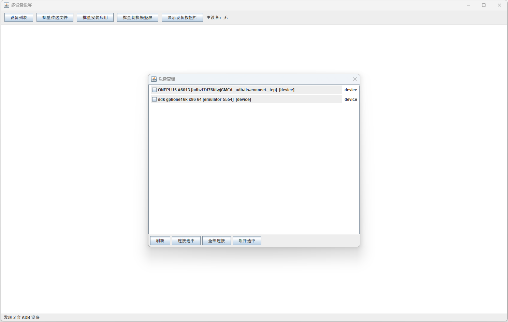
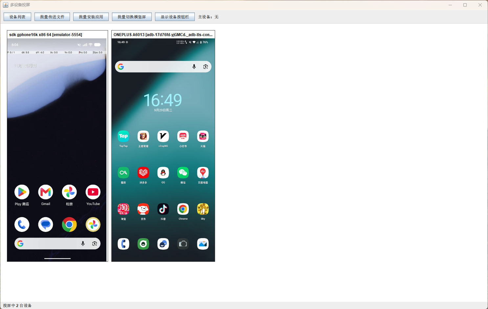
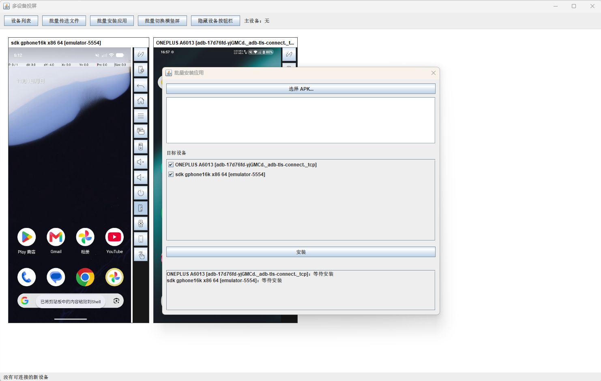
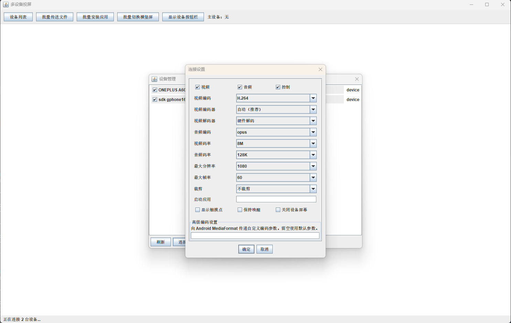

# scrcpy-java

<p align="center">
  <strong>A Java desktop client for Android multi-device screen mirroring and group control</strong>
</p>

<p align="center">
  Simultaneous mirroring · Primary-device control · Synchronized group operations · Batch file transfer · Batch APK installation
</p>

<p align="center">
  <a href="README.md">简体中文</a>
</p>

---

## Overview

**scrcpy-java** is a Java desktop client for mirroring and controlling Android devices. It communicates with Android devices through the [scrcpy](https://github.com/Genymobile/scrcpy) Server 5.0.1 protocol.

Its key feature is **simultaneous multi-device screen mirroring and synchronized group control**. Multiple Android devices share one desktop workspace. Users can monitor their screens at the same time, designate one device as the primary device, and broadcast supported control actions to other connected devices.

Typical use cases include:

- Multi-device automation and compatibility testing
- Centralized management of Android device farms
- Operating multiple app accounts
- Workflows that require monitoring and controlling several devices at once

> **The project is under active development.** The Swing desktop client (`scrcpy-swing-poc`) is the current development focus. Feature availability may vary by operating system and runtime environment.

## Features

### Multi-device mirroring and group control

- **Simultaneous mirroring:** Display multiple Android devices in one desktop window.
- **Primary-device mode:** Enlarge the selected primary device while arranging the remaining devices in smaller views.
- **Synchronized operations:** Send supported control actions performed on the primary device to other connected devices.
- **Coordinate adaptation:** Adapt control coordinates for group operations to reduce discrepancies caused by different device resolutions or display dimensions.
- **Flexible layout:** Keep device views embedded in the main workspace or detach them into independent windows.
- **Device management:** View the device list, refresh device status, and connect or disconnect devices.

### Device controls

- Android touch input.
- UHID mouse and keyboard control, subject to device and environment support.
- Common Android actions, including Back, Home, Recents, Power, and volume controls.
- Screen on/off and keep-awake controls.
- Clipboard text interaction between the desktop and Android devices.

### Batch operations

- **Batch file transfer:** Send files to multiple selected devices in one operation.
- **Per-device transfer progress:** View the progress and completion status of each device independently.
- **Batch APK installation:** Install an APK on multiple selected Android devices.
- **Task status tracking:** Monitor each device's task status and identify devices that need attention.

### Audio, video, and connection settings

- Receive video, audio, and control data from scrcpy Server.
- Decode supported video and audio formats using FFmpeg.
- Configure connection parameters such as video resolution, frame rate, bit rate, and encoder. Available options depend on the client version.
- Integrate a native D3D11 video-rendering path on Windows. Actual hardware capabilities depend on the GPU, driver, and runtime environment.

## Screenshots

### 1. Simultaneous multi-device mirroring

View multiple Android devices in the same workspace without switching between individual mirroring windows.



### 2. Group control — embedded mode

Keep multiple devices in one workspace and use the primary device for centralized operations.



### 3. Group control — independent windows

Detach device views into independent windows and arrange them as needed on the desktop.



### 4. Device list and workspace

Device list and workspace display.





### 5. Batch file transfer

Select target devices, send files in batches, and view the transfer progress for each device.


### 6. Batch application installation

Install APK files on multiple selected Android devices.



### 7. Device connection settings

Adjust mirroring connection parameters according to the device and network environment.



## Getting started

### Requirements

- **JDK:** 25
- **Maven:** 3.9 or later
- **ADB:** Android Debug Bridge
- **Android device:** Developer options and USB debugging enabled, or an existing ADB TCP/IP connection

Authorize ADB debugging on the computer and make sure the device is visible to ADB before launching the client.

### 1. Clone the repository

```bash
git clone https://github.com/849029780/scrcpy-java.git
cd scrcpy-java
```

### 2. Connect an Android device

Enable **Developer options → USB debugging** on the Android device.

Connect the device over USB and run:

```bash
adb devices
```

Make sure the device state is `device`. For a network ADB connection, run:

```bash
adb connect <device-ip>:<port>
```

### 3. Build and launch the Swing client

From the project root, build the client:

```bash
mvn -pl scrcpy-swing-poc -am package
```

Launch it with:

```bash
mvn -pl scrcpy-swing-poc -am exec:java
```

Swing application entry point:

```text
com.jian.scrcpy.swing.SwingScrcpyApp
```

> The native D3D11 rendering path on Windows requires the corresponding native library to be deployed correctly. Hardware rendering may be unavailable if the native library is missing or cannot be loaded.

## Technology stack

| Technology / module | Purpose |
| --- | --- |
| Java 25 | Main development language |
| Java Swing | Current desktop UI |
| Maven | Multi-module build and dependency management |
| ADB | Android device discovery, connection, and command execution |
| scrcpy Server 5.0.1 | Android-side screen capture and control protocol |
| Netty 4.2.x | Video, audio, and control data transport |
| FFmpeg 8.1.2 / JavaCPP | Audio and video decoding |
| D3D11 | Native video-rendering integration on Windows |

### Maven modules

| Module | Description |
| --- | --- |
| `scrcpy-core` | Core scrcpy protocol, ADB integration, Netty transport, media processing, and device sessions |
| `scrcpy-swing-poc` | Swing desktop client, multi-device workspace, and group-control interactions |
| `scrcpy-app` | Legacy JavaFX desktop client. This implementation is deprecated because its hardware-decoding implementation is comparatively complex. |

## Project status and notes

- The target protocol version is **scrcpy Server 5.0.1**. The server artifact is bundled with the Swing client; no separate setup is required.
- This is an independent Java client, not the official Genymobile scrcpy project.
- Some features depend on the operating system, device capabilities, ADB state, graphics drivers, and native components.
- The project is actively evolving. Bug reports and feature requests are welcome through GitHub Issues.

## Acknowledgements

Thanks to these open-source projects:

- [Genymobile/scrcpy](https://github.com/Genymobile/scrcpy) — Android screen mirroring and control protocol
- [Netty](https://netty.io/) — Asynchronous networking framework
- [FFmpeg](https://ffmpeg.org/) — Audio and video processing
- [JavaCPP](https://github.com/bytedeco/javacpp) — Java bindings for native libraries

## License

Refer to the license file in this repository and the notices for third-party components.
